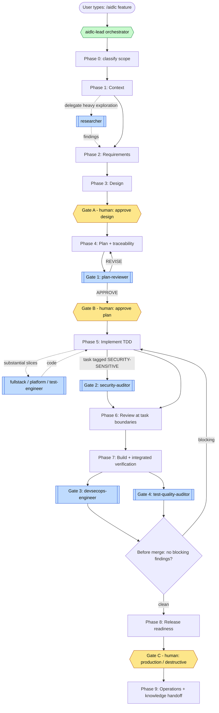

# team-leader — the orchestrator agent

`team-leader` is the central agent in this collection. It has no `Write`/`Edit`
access by design: it plans, delegates every code change to a specialist agent
(`researcher`, `plan-reviewer`, `security-auditor`, `test-quality-auditor`,
`devsecops-engineer`, `test-engineer`, `fullstack-engineer`,
`platform-engineer`), and verifies results with read-only tools.

Source: [`agents/project-agents/team-leader.md`](../agents/project-agents/team-leader.md)
(originally from [`sub-agent-team-ai`](../CREDITS.md#claude-agents-superpowers) —
see `CREDITS.md`).

## Three ways to invoke it (Claude Code)

1. **Whole session**, one-off:
   ```bash
   claude --agent team-leader
   ```
   `team-leader`'s system prompt replaces the default one for the session.
   Project `CLAUDE.md` still loads normally.

2. **Project default**, every session in that repo:
   add to `<project>/.claude/settings.json`:
   ```json
   {
     "agent": "team-leader"
   }
   ```
   This is Claude Code's documented `agent` setting
   (https://code.claude.com/docs/en/sub-agents#invoke-subagents-explicitly) —
   confirmed against the current docs while building this repo. The `--agent`
   CLI flag overrides this setting if both are present.

3. **One task at a time**, inside an otherwise-normal session:
   ```text
   @team-leader plan and ship the CSV export feature
   ```

The installer (`install/install-claude.sh --set-default-agent <project-path>`)
can write step 2 for you — see `install/README` usage notes below.

## The same idea on other CLIs — verified feature parity

An earlier version of this doc claimed sub-agents were "a Claude Code feature
specifically" and that Codex/Gemini had no sub-agent system. **That is no
longer true** — as of the versions below, **all four CLIs support real
sub-agent delegation.** What actually differs between them is (a) how a skill
is invoked, (b) whether there is a first-class default-agent switch, and
(c) whether a sub-agent may itself spawn sub-agents. Verified 2026-07 against
official docs **and** the local binaries:

| CLI (version) | Skill (`/aidlc`) invocation | Sub-agents / delegation | Default-agent switch | Verified against |
|---|---|---|---|---|
| **Kiro CLI 2.13.0** | `/aidlc` slash command | ✅ `subagent` tool + `toolsSettings.subagent.availableAgents`/`trustedAgents`; agents = JSON in `~/.kiro/agents/` | ✅ `kiro-cli agent set-default` (→ `chat.defaultAgent`) | live install + `kiro-cli agent validate` + `agent list` |
| **Claude Code 2.1.216** | `/aidlc` slash **and** auto-by-description | ✅ `Agent` tool; agents = markdown in `~/.claude/agents/`; sub-agents can nest (depth 5) and can also write | ✅ `settings.json` `agent` key + `--agent` flag | official docs + local `claude --help` |
| **Codex CLI 0.144.6** | `$aidlc` **or** auto (no per-skill slash) | ✅ `features.multi_agent` (on by default); agents = TOML in `~/.codex/agents/`; `agents.max_depth` default **1** (root spawns children only) | ❌ no selector — orchestrate from the root via `AGENTS.md`, or switch threads with `/agent` | official docs + local install (`~/.codex/skills/.system`, `config.toml`) |
| **Gemini CLI 0.51.0** | auto-by-description + consent (no per-skill slash) | ✅ agents = markdown in `~/.gemini/agents/`; invoke with `@name`; **a sub-agent cannot spawn sub-agents** | ❌ no selector — main-agent persona comes from `GEMINI.md` | official docs (v0.51.0 tag) + local `gemini --help` |

Practical upshot:

- **Kiro & Claude** give the smoothest experience: a real default-agent
  switch **and** `/aidlc` as a slash command. `install-kiro.sh` /
  `install-claude.sh --install-agents --set-default-agent` sets `aidlc-lead`
  as default; then just type `/aidlc`.
- **Codex** has real sub-agents but no default-agent and no `/`-skill: run the
  skill with `$aidlc` (or let it auto-match), and let the **root** agent
  orchestrate per `AGENTS.md`, spawning the installed specialist agents. Note
  the depth-1 limit — the root spawns specialists, specialists don't nest.
- **Gemini** has real sub-agents too, but no default-agent, no `/`-skill, and
  **no sub-agent recursion**. So the orchestrator role (`aidlc-lead`) is best
  driven from the **main session** (its persona/rules live in `GEMINI.md`),
  delegating to the specialist sub-agents with `@name`.

On **Codex and Gemini**, `install-codex.sh` / `install-gemini.sh` merge a
compact root/main-agent gate-map ([`docs/AIDLC_ORCHESTRATION.md`](AIDLC_ORCHESTRATION.md))
into `AGENTS.md` / `GEMINI.md` under its own `AI_TEAM_AIDLC_ORCHESTRATION`
marker (separate from the global rule). That is what lets the root/main agent
drive the workflow and delegate to specialists — since a spawned `aidlc-lead`
cannot delegate there (Codex depth-1, Gemini no recursion). On Kiro/Claude the
`aidlc-lead` agent already carries this, so the merge is Codex/Gemini-only.

Agent rosters per platform (same prompts, platform-native formats):

| Platform | Roster location | Format | Source of truth |
|---|---|---|---|
| Kiro | `agents/kiro-agents/*.json` | classic JSON | hand-maintained (Kiro-specific subagent config) |
| Claude | `agents/project-agents/*.md` + `agents/user-agents/*.md` | markdown | **canonical** |
| Codex | `agents/codex-agents/*.toml` | TOML | generated from Claude markdown |
| Gemini | `agents/gemini-agents/*.md` | markdown | generated from Claude markdown |

The Codex and Gemini rosters are produced by
[`install/generate-agents.py`](../install/generate-agents.py) from the Claude
markdown agents, so the role prompts stay in one place. Re-run it after editing
any `agents/project-agents/` or `agents/user-agents/` file.

## Model escalation policy (all CLIs)

`team-leader.md` carries its own escalation policy in its system prompt —
route routine work to `sonnet`/inherit, escalate to `opus`/`fable` only for:

1. hard logic (concurrency, distributed consistency, crypto, complex state
   machines, unclear performance trade-offs);
2. high-stakes, hard-to-reverse decisions (architecture, pre-prod security
   verdicts);
3. repeated failure (same sonnet mistake twice, or reviewers disagreeing);
4. ambiguous requirements where a wrong guess is expensive.

Budget escalation to 1-2 dispatches per branch, and never for routine tasks.
See the full text in `agents/project-agents/team-leader.md`.


## Kiro CLI: the `/aidlc` command and the `aidlc-lead` orchestrator

Verified against a live **kiro-cli 2.13.0** install (amazon-q-developer-cli
lineage). Three facts drive the Kiro setup:

1. **Skills become slash commands automatically.** The `aidlc` skill
   installs to `~/.kiro/skills/aidlc/SKILL.md`, so `/aidlc` just works — it is
   the full AI-DLC phase engine (context → requirements → design → tasks →
   implement → build → deploy), and all its phase skills (`aidlc-*`) ship in
   this repo.
2. **Subagent delegation is real on 2.x.** A custom orchestrator needs the
   `subagent` tool in its `tools`, and scopes who it may spawn via
   `toolsSettings.subagent.availableAgents` / `trustedAgents` (glob-friendly).
3. **There is a real default-agent switch:** `kiro-cli agent set-default <name>`
   (persists `chat.defaultAgent` in `~/.kiro/settings/cli.json`).

### Two orchestrators, on purpose

The AI-DLC skill writes its own spec/plan artifacts through the *active*
agent, which conflicts with `team-leader`'s no-write-by-design contract. So
the Kiro roster ships **two** orchestrators:

| Agent | Writes files? | Role |
|---|---|---|
| `aidlc-lead` | Yes | **Default agent for `/aidlc`.** Drives the SDLC phases, authors planning/spec artifacts, and delegates review gates + heavy implementation to the specialists. |
| `team-leader` | No (read-only) | Pure orchestrator, faithful parity with the Claude `team-leader.md`. Delegates *everything* including writes. Use it when you want strict separation. |

Both carry the `subagent` tool and pre-trust the read-only reviewers
(`researcher`, `plan-reviewer`, `security-auditor`, `test-quality-auditor`,
`devsecops-engineer`) so those run without a prompt; the write-capable
engineers (`fullstack-engineer`, `platform-engineer`, `test-engineer`) are
spawnable but still ask first.

### How the gates map onto `/aidlc`

`aidlc-lead` layers the review gates from [`WORKFLOW.md`](WORKFLOW.md) on top
of the skill's phase flow:

- Plan ready → **Gate 1** delegate to `plan-reviewer` (mandatory, loops until APPROVE)
- SECURITY-SENSITIVE task implemented → **Gate 2** delegate to `security-auditor`
- Before merge → **Gate 3** `devsecops-engineer` (secrets/CVE/CI/IaC/container) + **Gate 4** `test-quality-auditor` (fake-test audit)
- Human gates A (design), B (plan), C (production/destructive) still stop for you.



Reading the diagram: green = the `aidlc-lead` orchestrator (drives every
phase and authors spec/plan artifacts itself); blue = a spawned sub-agent
(`[[double-bordered]]` nodes); amber = a hard stop for the human. Solid
arrows are the phase flow; dotted arrows are delegation-and-return. Gate 1
loops back to planning until `plan-reviewer` returns APPROVE, and any
blocking finding at merge time sends work back to implementation.

### Install and run

```bash
./install/install-kiro.sh --install-agents --set-default-agent
# installs the whole agents/kiro-agents/ roster into ~/.kiro/agents/,
# then: kiro-cli agent set-default aidlc-lead

kiro-cli chat            # starts on aidlc-lead
> /aidlc build the CSV export feature
```

Prefer the strict read-only orchestrator instead?
`./install/install-kiro.sh --install-agents --set-default-agent --default-agent team-leader`

**Per-project (workspace) scope** — install into `<project>/.kiro/` instead of
`~/.kiro/`, so the whole `/aidlc` toolkit travels with the repo and can be
git-committed. Workspace agents/skills override global ones of the same name:

```bash
./install/install-kiro.sh --project ~/code/my-app --install-agents --set-default-agent
# -> writes <my-app>/.kiro/{skills,agents,steering}, and sets the *workspace*
#    default via: kiro-cli settings --workspace chat.defaultAgent aidlc-lead
#    (persisted to <my-app>/.kiro/settings/cli.json; global settings untouched)

cd ~/code/my-app
kiro-cli chat            # picks up the workspace agents/skills; starts on aidlc-lead
> /aidlc build the CSV export feature
```

Run `kiro-cli` from inside the project directory so it discovers the workspace
scope (verified: `kiro-cli agent list` shows the roster as `Workspace`, and the
workspace default only applies in that repo).

The agent JSON in `docs/examples/kiro-team-leader.json` is now just a
single-file reference sample — the maintained, `kiro-cli agent validate`-clean
roster lives in [`agents/kiro-agents/`](../agents/kiro-agents/).
