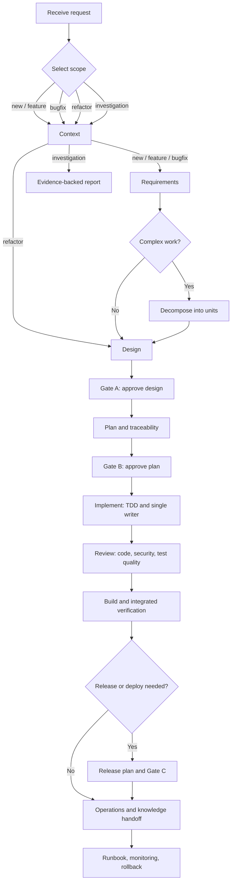

# AI Team Delivery Workflow

`WORKFLOW.md` is the canonical SDLC phase source for this repository. AIDLC-lite supplements rather than replaces the existing Superpowers, TDD, reviewer, and human-approval lifecycle.

## Entry contract

Start with:

- objective;
- business or operational context;
- repository or system in scope;
- `scope` (`new`, `feature`, `bugfix`, `refactor`, or `investigation`);
- constraints;
- risk level;
- expected deliverable;
- known acceptance criteria;
- required deadline or deployment window.

If essential information is missing, ask focused questions before implementation. Human authorization remains required for real deployments, migrations, credential changes, and external publications.

## Phase 0: Classify, route, and select scope

Classify the request and select one scope:

- `new`: a new capability or system.
- `feature`: an addition to an existing capability or system.
- `bugfix`: a verified defect correction.
- `refactor`: a structural change that preserves external behavior.
- `investigation`: evidence gathering and analysis without implementation.

Apply these fixed routing rules:

- `new` / `feature`: all phases; decompose only when the work is complex.
- `bugfix`: lightweight requirements, regression coverage, no release phase unless deployment is requested.
- `refactor`: preserve external behavior; skip requirements and release unless behavior or deployment changes.
- `investigation`: establish context and return an evidence-backed report; do not implement without a separate request.

Work is complex when it crosses two independent domains, requires multiple owners, or is too large to verify as one bounded change. Complex work must be decomposed into independently testable units before detailed design and planning.

Select the primary owner:

- Claude for requirement analysis, architecture, trade-offs, and synthesis.
- Codex for repository edits, tests, debugging, and delivery.
- Gemini/Antigravity for current Google ecosystem research or independent validation.
- Human for approval, risk acceptance, production authorization, and final decisions.

Output: task classification, scope, primary owner, risk level, and required approval gates.

## Scope-adaptive paths

| Scope | Required path | Intent |
|---|---|---|
| `new` / `feature` | all phases; decompose only if complex | new capability or system |
| `bugfix` | context → lightweight requirements → design → plan → execute → review → verify → operations/handoff | prove the defect and add regression coverage |
| `refactor` | context → design → plan → execute → review → verify → operations/handoff | preserve external behavior while changing structure |
| `investigation` | route → context → evidence-backed report | no implementation unless separately authorized |



## Phase-to-artifact mapping

| Phase | Artifact |
|---|---|
| 1 | context evidence |
| 2 | requirements and optional independently testable units |
| 3 | design and ADR |
| 4 | implementation plan and trace matrix |
| 7 | verification evidence |
| 8 | release plan |
| 9 | runbook and knowledge handoff |

Use [`docs/templates/sdlc-work-item.md`](templates/sdlc-work-item.md) as the copyable work record. The work-item record and trace matrix are required for multi-step, security-sensitive, or production-affecting work, and optional for trivial work. Keep evidence factual and write `NOT VERIFIED` where proof is absent.

## Phase 1: Establish repository truth

1. Read repository-local instructions.
2. Check Git status and preserve unrelated user changes.
3. Inspect structure, dependencies, tests, build system, and deployment mechanism.
4. If `.codegraph/` exists, use CodeGraph for code paths and impact.
5. If `graphify-out/graph.json` exists, use Graphify for cross-domain architecture.
6. Record facts, assumptions, unknowns, and risks separately.

Do not edit during this phase unless the request is a trivial, explicitly authorized change.

Output: current-state summary and evidence.

## Phase 2: Define requirements and decompose complex work

Assign requirement IDs and prioritized acceptance criteria before design. For a `bugfix`, create a lightweight requirements record that states the defect, expected correction, and required regression coverage. A `refactor` may skip requirements only while it preserves external behavior; define requirements if behavior changes.

For complex `new` or `feature` work, define independently testable units with clear dependencies before Phase 3. Record the requirements and units in the work-item record whenever the record is required.

Output: requirement IDs, prioritized acceptance criteria, and, when applicable, independently testable units and their dependencies.

## Phase 3: Design the solution and operations

Activate Superpowers `brainstorming` after requirements exist.

Claude should:

1. clarify the problem and non-goals;
2. identify at least one viable approach and alternatives when meaningful;
3. compare security, reliability, complexity, cost, operability, migration, and rollback;
4. apply Ponytail to remove unjustified complexity;
5. define security controls, non-functional requirements, observability, acceptance criteria, and Definition of Done;
6. state migration and rollback strategy;
7. present the recommended design in reviewable sections.

For an independent challenge from Codex inside Claude Code:

```text
/codex:adversarial-review --background challenge the proposed architecture, hidden assumptions, security boundaries, data-loss risks, rollback, race conditions, and operational failure modes
```

Check progress and retrieve results:

```text
/codex:status
/codex:result
```

Claude reconciles valid findings into the design. Do not treat reviewer output as automatically correct.

### Gate A: Human design approval

Stop and request explicit approval before implementation when the change affects architecture, security, data, cost, public contracts, infrastructure, or production behavior.

Approved output: design document or ADR, acceptance criteria, Definition of Done, risk register, observability approach, and rollback outline.

### After Gate A: Isolate the work

Activate `using-git-worktrees` after design approval.

1. Create an isolated branch/worktree using repository conventions.
2. Install dependencies using approved sources.
3. Run the relevant baseline tests before editing.
4. If the baseline is already failing, record the exact failures and decide whether they block the task.

Output: branch/worktree, clean or documented baseline, and starting commit.

## Phase 4: Write the implementation plan and traceability

Activate `writing-plans`.

Each plan item must contain:

- objective and acceptance criterion;
- exact files or components;
- expected behavior;
- test-first step;
- implementation step;
- verification command;
- rollback or recovery note when relevant;
- dependencies and approval requirement.

Keep tasks small enough to verify independently. Avoid inventing future abstractions. When the global constraints require a work-item record, complete its trace matrix to link each `REQ-*` through design, task, test, and `VERIFY-*` evidence. Mark unavailable proof `NOT VERIFIED` rather than inferring it.

### Gate B: Plan approval

For high-risk or multi-system work, the human approves the plan before execution. Low-risk work may proceed after the plan is presented unless the user requests a checkpoint.

## Phase 5: Execute with a single active writer

Choose one Superpowers mode:

- `subagent-driven-development` for well-separated tasks with independent review.
- `executing-plans` for tightly coupled tasks or when sequential context matters.

Apply `test-driven-development` for behavioral code changes:

1. RED: create or identify a test that fails for the intended reason.
2. GREEN: implement the smallest safe change that passes.
3. REFACTOR: improve structure without changing behavior.
4. Run focused tests, then broader relevant tests.

Apply Ponytail at every task boundary, but retain required enterprise controls.

### Delegating implementation to Codex from Claude Code

Use the correct command name, `/codex:rescue`:

```text
/codex:rescue --background implement the next approved plan item with the smallest safe patch, follow TDD, preserve unrelated changes, run the specified verification, and report evidence
```

For investigation only:

```text
/codex:rescue --background investigate the failure, identify the root cause with evidence, and do not modify files
```

For a focused fix:

```text
/codex:rescue --background fix the verified root cause with the smallest safe patch and run the relevant tests
```

Manage the job:

```text
/codex:status
/codex:result
/codex:cancel
```

Before accepting delegated work, inspect the diff and verify the evidence. Never let Claude and Codex edit the same worktree concurrently.

## Phase 6: Review at task boundaries

Activate `requesting-code-review` between meaningful tasks.

Run a normal Codex review:

```text
/codex:review --background
```

For branch-level review:

```text
/codex:review --base main --background
```

For risk-focused review:

```text
/codex:adversarial-review --base main --background challenge auth, authorization, secret handling, data integrity, rollback, concurrency, retries, observability, and operational failure modes
```

Then:

```text
/codex:status
/codex:result
```

Classify findings:

- blocking: security, data loss, broken acceptance criteria, unsafe operations, or failing required tests;
- important: reliability, maintainability, performance, or operability risk;
- optional: preference or non-required improvement.

Fix blocking and accepted important findings. Re-run affected tests and review. Do not implement optional suggestions merely to satisfy the reviewer.

## Phase 7: Integrated build and verification

Run validation proportionate to risk:

- focused unit and integration tests;
- full relevant test suite;
- lint, type check, formatting, build, and package validation;
- container build and startup checks;
- IaC validation and plan without unauthorized apply;
- Kubernetes schema, policy, and rendered-manifest checks;
- security and secret scanning;
- migration dry-run and rollback rehearsal where applicable;
- documentation link and command validation.

Compare results against every acceptance criterion. Record requirement-to-verification gaps in the work-item trace matrix, using `NOT VERIFIED` for unavailable proof.

## Phase 8: Release readiness and branch completion

For a requested release or deployment, prepare release readiness evidence, a deployment plan, required human approval, smoke-test evidence, and a rollback plan. A `bugfix` skips this release activity unless deployment is requested; a `refactor` skips it unless behavior or deployment changes.

### Gate C: Production or destructive approval

Stop before deployment, destructive commands, data migration, credential rotation, external publication, or irreversible operations unless explicitly authorized. Real deployments, migrations, credential changes, and external publications require human authorization.

Activate `finishing-a-development-branch`.

1. Confirm required checks pass.
2. Confirm no unresolved blocking review findings.
3. Present merge, PR, keep, or discard options.
4. Do not merge, push, deploy, or delete a worktree without authorization when not already included in the request.
5. Preserve a clear rollback point.

If moving the active Claude session into Codex for continued hands-on work:

```text
/codex:transfer
```

Use the returned `codex resume <session-id>` command to continue in Codex.

## Phase 9: Operations and durable knowledge

Before handoff, provide a runbook path, monitoring and alert ownership when applicable, recovery instructions, and a verified knowledge handoff. Do not describe an outcome as verified without evidence; record `NOT VERIFIED` where proof is absent.

After verification, update Obsidian Second Brain with:

- approved design and ADR;
- decisions and rejected alternatives;
- verified implementation outcome;
- runbook and rollback instructions;
- unresolved risks and follow-up tasks;
- source links and `as of` dates.

Use the platform-appropriate Obsidian command. Examples:

- Claude Code: `/obsidian-second-brain:obsidian-save`
- Codex CLI: `$obsidian-save`
- Gemini CLI: `/obsidian-save`
- Kiro CLI: `/obsidian-save`

Only one agent writes the vault at a time. Do not save secrets or unverified conclusions.

## Traceability

For work requiring the work-item record, link each requirement through design, task, test, and verification evidence with the complete pattern `REQ-*` → design decision → task → test → `VERIFY-*`. Use the template trace matrix and write `NOT VERIFIED` whenever an evidence link is unavailable.

## Final handoff template

```text
Outcome:
- <what is now true>

Changed:
- <files, components, or systems>

Verified:
- <command/check>: <result>

Acceptance criteria:
- <criterion>: PASS | FAIL | NOT VERIFIED

Reviews:
- Normal review: <result>
- Adversarial review: <result>

Risks and assumptions:
- <remaining item or none>

Rollback:
- <recovery path>

Next approval/action:
- <owner and action or none>
```
