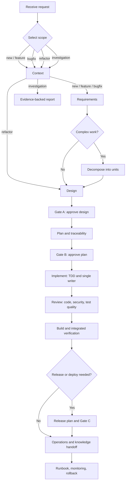

# AIDLC-lite SDLC workflow design

**Status:** Approved and implemented on 2026-07-21
**Date:** 2026-07-21
**Scope:** Documentation, templates, and agent guidance in `pasitc-ai-agents-skills`

## Goal

Extend the existing AI-team delivery workflow into a complete, lightweight
SDLC. Retain the repository's Superpowers lifecycle, TDD, reviewer gates, and
human approvals; add the AIDLC ideas that are currently missing: adaptable
scope, traceability, release readiness, and operational handoff.

## Non-goals

- Do not vendor the complete AIDLC skill suite or its runtime manifest system.
- Do not generate CI/CD, infrastructure, or deployment configuration.
- Do not automate deployments or weaken the existing human approval gates.
- Do not replace Superpowers, the current specialist agents, or the current
  security and quality reviews.

## Workflow model

`docs/WORKFLOW.md` becomes the single canonical lifecycle document. It will
retain its ten phases but clarify their SDLC purpose and expected artifacts.

### Phase mapping

| Phase | SDLC outcome | Required control |
|---|---|---|
| 0. Route | classify request and scope | human owns risk and approvals |
| 1. Context | repository facts, constraints, risks | no edits unless explicitly authorized |
| 2. Requirements | prioritized requirements and acceptance criteria | clarification checkpoint |
| 3. Design | architecture, NFRs, security, operations, rollback | Gate A: human approval |
| 4. Plan | small implementation tasks and trace matrix | Gate B: plan review / approval |
| 5. Execute | implementation and focused tests | TDD, one active writer |
| 6. Review | code, security, and test-quality findings resolved | appropriate specialist gates |
| 7. Verify | integrated build, tests, quality, and security evidence | no completion claim without evidence |
| 8. Release | release readiness, deployment plan, and recovery | Gate C: explicit approval before real deployment |
| 9. Operate | runbook, monitoring ownership, rollback, durable knowledge | verified handoff only |

## Scope-adaptive paths

| Scope | Required path | Intent |
|---|---|---|
| `new` / `feature` | all phases; decompose only if complex | new capability or system |
| `bugfix` | context → lightweight requirements → design → plan → execute → review → verify → operations/handoff | prove the defect and add regression coverage; no release phase unless deployment is requested |
| `refactor` | context → design → plan → execute → review → verify → operations/handoff | preserve external behavior while changing structure; skip requirements and release unless behavior or deployment changes |
| `investigation` | route → context → evidence-backed report | no implementation unless separately authorized |

Work is considered complex when it crosses two or more independent domains,
requires multiple owners, or cannot be verified as one bounded change. In
those cases, decompose it into independently testable units before detailed
design and planning.

## Work-item record and traceability

Add `docs/templates/sdlc-work-item.md`, a copyable single-file template for
target repositories. The recommended destination is
`docs/work-items/<feature>.md`. It contains:

- request context, scope, owner, risk, and decision log;
- requirement IDs and acceptance criteria;
- design and non-functional decisions;
- implementation tasks and verification commands;
- a trace matrix using `REQ-* → DES-* → TASK-* → TEST-* → VERIFY-*`;
- release readiness, deployment approval, rollback, monitoring, and runbook
  ownership.

The record is optional for trivial changes but required for multi-step,
security-sensitive, or production-affecting work. It is a lightweight resume
record, not a machine-managed manifest.

## Integration with existing guidance

- `docs/GLOBAL_RULE.md` will require scope selection and traceability when a
  work-item record is required, and will clarify that release planning and
  operational handoff precede completion.
- `agents/project-agents/team-leader.md` will route work through the selected
  scope, request decomposition when necessary, and require the trace matrix
  as evidence at phase boundaries.
- `README.md` will describe the complete SDLC workflow, the optional
  work-item record, and the Mermaid diagram's meaning.
- `docs/WORKFLOW.md` remains the single source of truth; the README and agent
  instructions link to it rather than repeating the lifecycle.

## Error handling and safety

- Missing or ambiguous requirements stop before design or implementation.
- An incomplete trace matrix is reported as an unverified item, never filled
  with assumptions.
- Build, test, security, or review failures block release readiness until they
  are accepted by the human owner or resolved with evidence.
- Phase 8 produces a release plan and checklist only; any actual deployment,
  migration, credential action, or irreversible operation still requires
  separate explicit authorization.

## Acceptance criteria

1. The workflow describes all SDLC stages from request routing through
   operations, without removing current review or approval gates.
2. Each supported scope states which stages are required or intentionally
   skipped.
3. Multi-step work has a documented requirement-to-verification trace path.
4. Release readiness includes deployment approval, rollback, and operational
   ownership, but never authorizes automatic deployment.
5. The Mermaid diagram renders the core path and its decision points.
6. Documentation links and instructions remain internally consistent.

## Verification plan

- Validate Markdown links and referenced local paths.
- Check Mermaid fences and the diagram's node references statically.
- Review the changed documentation for contradictory phase, gate, and scope
  definitions.
- Run the repository's available structural checks; no first-party automated
  documentation test suite currently exists.

## Rollback

Revert the documentation commit. No installer, tool configuration, user
project, deployment, or external system changes are part of this work.
